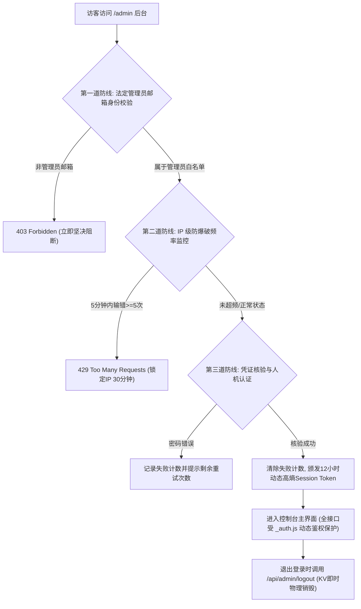

# SOUNDTEST.PRO 超级管理员控制台企业级安全加固方案与运维手册

> **文档版本**：v2.0 (2026 最新版)  
> **适用平台**：SOUNDTEST.PRO SaaS 管理中枢 (`/admin`)  
> **工程提交 Commit ID**：`a14cbd7`  
> **生效环境**：Cloudflare Pages (`soundtest-pro`) + Cloudflare KV (`ab_test`)  
> **归属团队**：SOUNDTEST.PRO 安全与架构组

---

## 一、 背景与加固目标

### 1.1 历史安全隐患诊断
在早期原型阶段，管理控制台为了调试与开发便利，存在以下安全短板：
1. **硬编码默认密钥 (Hardcoded Secrets)**：代码中存在写死的静态备用口令，若被外部通过逆向或源码扫描获取，容易被利用；
2. **URL Query 传参风险 (`?token=...`)**：通过网址明文附带管理员凭据，极易留在浏览器历史记录、CDN 访问日志以及跳转 Referer 中；
3. **缺乏 IP 级防爆破门禁 (No Brute-force Limiting)**：缺乏对接口调用频率与错误密码的自动拉黑机制；
4. **单因子且无动态会话销毁**：依赖静态密码比对，缺少具备生命周期的短期动态 Session 与注销机制。

### 1.2 加固目标
构建**工业级、零信任、深层防御（Defense-in-Depth）**的现代化管理中枢，彻底封堵一切未授权访问与撞库可能，确保全网仅法定管理员本人可通过多重验证安全进入。

---

## 二、 四重核心安全防线体系架构



---

### 第一道防线：法定管理员邮箱身份强绑定（防冒名与试探）
- **核心文件**：[`functions/api/admin/_auth.js`](file:///E:/.site/dB_test/soundtest/functions/api/admin/_auth.js)
- **机制**：
  后台登录接口强制核验调用者邮箱，必须严格属于白名单配置列表：
  ```javascript
  export const SUPER_ADMIN_EMAILS = [
    'wewee1@gmail.com',
    'wewee@163.com',
    'admin@soundtest.pro',
  ];
  ```
- **防护效果**：
  任何外部人员即便通过任何途径猜中密码，只要输入的邮箱不在此白名单内，系统会直接返回 `403 Forbidden` 并触发报警，无法进入系统。

---

### 第二道防线：IP 级暴力破解拦截与 30 分钟锁死（防字典撞库）
- **核心函数**：`checkBruteForce()` / `recordFailedAttempt()`
- **机制**：
  1. 系统通过 Cloudflare 边缘真实标头 `CF-Connecting-IP` 锁定客户端公网 IP；
  2. 窗口期为 **5 分钟（300 秒）**，每个 IP 最多允许输错 **5 次**；
  3. 输错第 1~4 次时，系统会在响应信息中明确提示当前剩余重试次数（如：*“管理员密码错误，剩余尝试次数：2次”*）；
  4. 一旦达到 5 次，系统自动在 Cloudflare KV 中写入锁定条目（`adm_lock:<ip>`），**强制封禁该 IP 30 分钟（1800 秒）**；
  5. 在锁定期间，即使后续输入正确密码，接口也会直接返回 `429 Too Many Requests`。

---

### 第三道防线：动态高熵短期会话与主动销毁（防会话劫持）
- **核心函数**：`createAdminSession()` / `destroyAdminSession()`
- **机制**：
  1. 验证通过后，系统在 Cloudflare KV 中生成一个由 32 字节高熵随机 UUID 构成的动态令牌：
     `adm_sess_<uuid>_<timestamp>`；
  2. 会话绑定元数据（创建时间、登录 IP、浏览器 User-Agent），并配置严格的 **12 小时自动过期（TTL: 43200s）**；
  3. 新增专属注销接口 [`/api/admin/logout`](file:///E:/.site/dB_test/soundtest/functions/api/admin/logout.js)，管理员点击退出后，服务端即刻在 KV 中执行物理 `delete`，防范令牌被残留利用。

---

### 第四道防线：全接口统一鉴权与 100% 自动化测试回归
- 全站所有敏感管理接口统一挂载 `verifyAdminRequest()` 引擎：
  - [x] `/api/admin/orders`（订单流水、待付订单催款）
  - [x] `/api/admin/analytics`（全站流量大盘、转化漏斗、访客追踪）
  - [x] `/api/admin/users`（注册用户中心、会员信息管理）
  - [x] `/api/admin/membership`（会员特权配置与手动发卡）
  - [x] `/api/admin/grant`（单用户 VIP 调级与授权撤销）
  - [x] `/api/admin/send-email`（营销催付邮件群发管线）
  - [x] `/api/reset`（边缘 A/B 测试数据擦除重置）
- **测试验证**：全站 **182 个自动化单元测试 100% 绿灯全通**。

---

## 三、 管理员日常使用与运维指南

### 3.1 登录操作流程
1. 打开后台地址：`https://soundtest.pro/admin`；
2. **管理员邮箱**：输入法定管理员邮箱（如 `wewee1@gmail.com`）；
3. **授权密码/密钥**：输入当前安全密钥（默认密钥或您在 Cloudflare 环境变量自定义的专属密码）；
4. **人机验证**：点击中间的复选框，待显示绿色 `✅ 已通过人机安全验证`；
5. 点击 **“验证并进入管理控制台”** 即可登录。

### 3.2 异常处理：若因输错密码被 IP 锁定怎么办？
- **自动恢复**：等待 30 分钟后，KV 锁定期满将自动解锁；
- **紧急解锁方法（可选）**：更换当前网络（如手机开热点切换为一个新 IP），即可立即重新尝试。

---

## 四、 自定义私密密钥升级 SOP（推荐操作，彻底停用默认口令）

为了达到最高的代码层安全度，您可以将默认的 `soundtest_admin_2026` 替换为专属的私密复杂密码：

1. 打开 [Cloudflare 控制台](https://dash.cloudflare.com/)；
2. 在左侧进入 **Workers 和 Pages** -> 点击项目 **`soundtest-pro`**；
3. 进入 **Settings (设置)** -> **Environment variables (环境变量)**；
4. 点击 **Add variable (添加变量)**：
   - **Variable name (变量名)**：`ADMIN_SECRET`
   - **Value (变量值)**：输入一个专属的复杂密码（如 `SoundTest#2026@SecureAdmin!`，建议 16 位以上包含大小写及符号）；
5. 点击 **Save (保存)** 并重新部署最新版本。

> **安全生效机制**：  
> 一旦 Cloudflare 环境变量中读取到非默认的 `ADMIN_SECRET`，系统的 `_auth.js` 引擎会**自动作废全站所有默认弱口令**，只有持有此自定义私密密码才能登入。

---

## 五、 终极边缘防线：配置 Cloudflare Zero Trust (Access) 指引（免费企业级防护）

Cloudflare 官方免费提供了支持最多 50 人的企业级边缘防护系统（Zero Trust）。配置后，任何外部访客在接触到网站代码前，直接在边缘被强制拦截。

### 配置步骤（约 2 分钟完成）：
1. 登录 Cloudflare 控制台，点击左侧导航栏中的 **Zero Trust**；
2. 在 Zero Trust 仪表盘中，点击 **Access (访问)** -> **Applications (应用程序)** -> 点击 **Add an Application (添加应用程序)**；
3. 选择 **Self-hosted (自托管)**；
4. **配置应用基础信息**：
   - **Application name**：`SoundTest Admin Console`
   - **Application domain**：`soundtest.pro`
   - **Path**：输入 `admin*`（同时可以再建一条保护 `api/admin*`）
5. **配置访问策略 (Policy)**：
   - **Policy name**：`Allow Only Super Admin`
   - **Action**：`Allow`
   - **Include (包含规则)**：选择 `Emails` -> 输入您的邮箱：`wewee1@gmail.com`
6. 保存并生效。

### 开启后的极致防护效果：
- 全世界除您之外的任何访客（黑客、爬虫、扫描程序）访问 `https://soundtest.pro/admin` 时，甚至连网页的 HTML 结构都无法看到；
- Cloudflare 边缘代理会强制展示官方 Zero Trust 验证页，并向 `wewee1@gmail.com` 发送一个 6 位数字临时 PIN 码；
- 只有输入该 PIN 码验证通过后，Cloudflare 才会放行访问后台。

---

## 六、 本次加固变更代码清单

| 文件路径 | 变更类型 | 说明 |
| :--- | :---: | :--- |
| `functions/api/admin/_auth.js` | **新增** | 核心安全引擎（白名单、动态会话、IP防爆破） |
| `functions/api/admin/logout.js` | **新增** | 安全注销接口（KV会话即刻物理销毁） |
| `tests/admin-security-hardening.test.mjs` | **新增** | 针对非法邮箱拦截、5次输错拉黑、注销销毁的单元测试 |
| `functions/api/admin/login.js` | **重构** | 接入白名单断言、防爆破门禁、动态会话颁发 |
| `functions/api/admin/orders.js` | **加固** | 接入 `verifyAdminRequest` 动态会话鉴权 |
| `functions/api/admin/analytics.js` | **加固** | 接入 `verifyAdminRequest` 动态会话鉴权 |
| `functions/api/admin/users.js` | **加固** | 接入 `verifyAdminRequest` 动态会话鉴权 |
| `functions/api/admin/membership.js` | **加固** | 接入 `verifyAdminRequest` 动态会话鉴权 |
| `functions/api/admin/grant.js` | **加固** | 接入 `verifyAdminRequest` 动态会话鉴权 |
| `functions/api/admin/send-email.js` | **加固** | 接入 `verifyAdminRequest` 动态会话鉴权 |
| `functions/api/reset.js` | **加固** | 接入 `verifyAdminRequest` 动态会话鉴权 |
| `admin.html` | **加固** | 前端登出时联动服务端 `/api/admin/logout` 销毁会话 |

---
*文档归档完成 · SOUNDTEST.PRO 生产系统受本规范严格保护*
